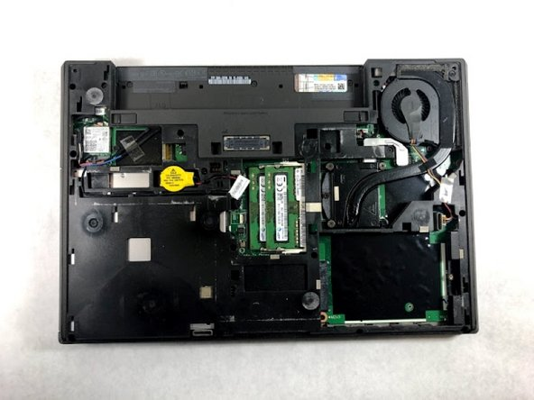
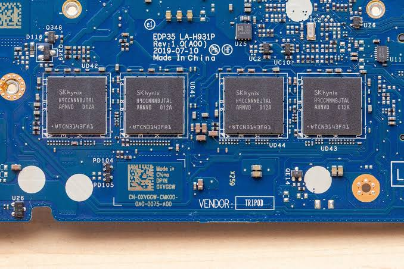
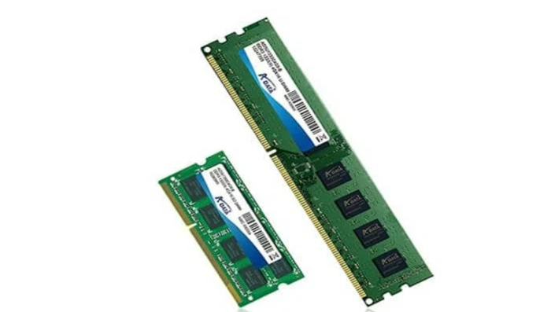
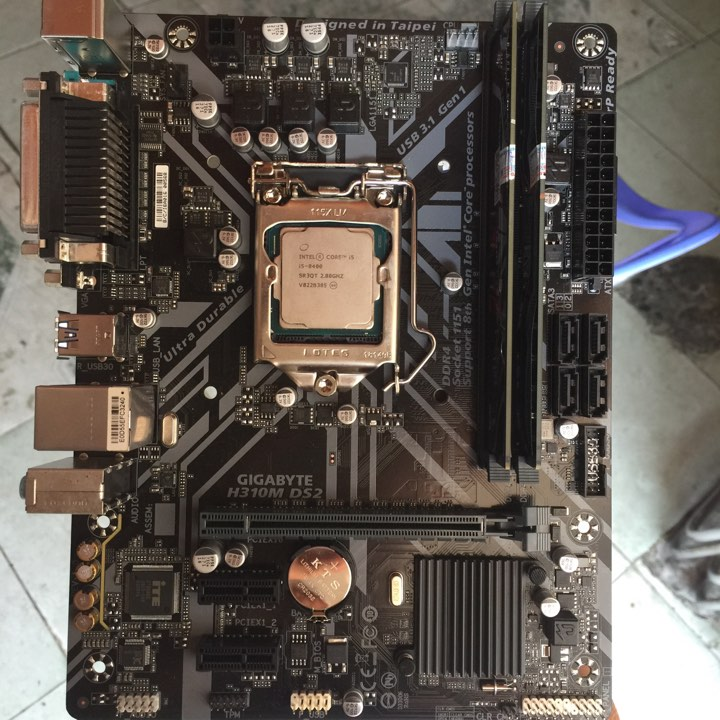
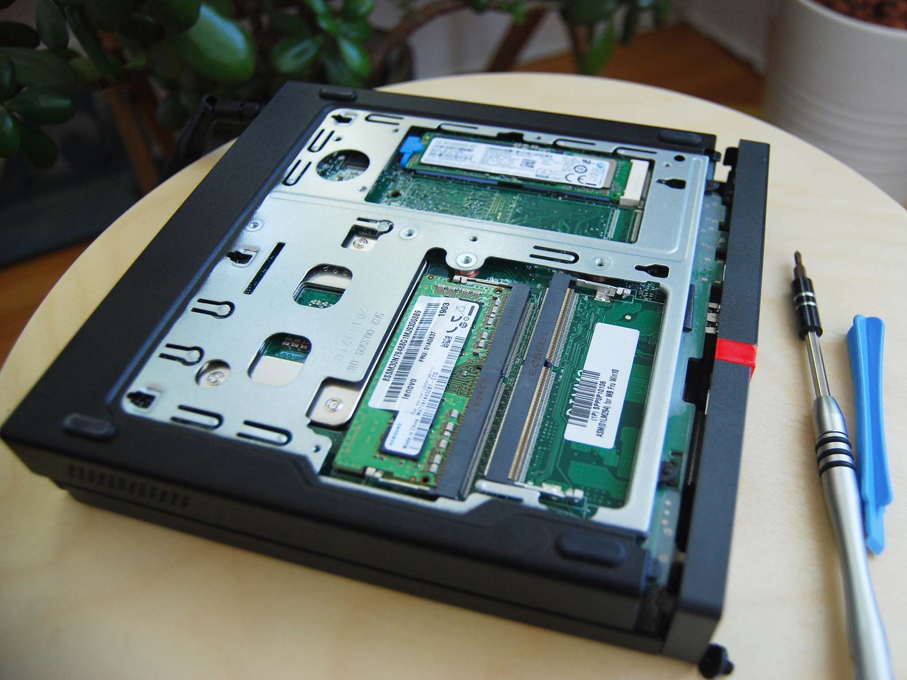
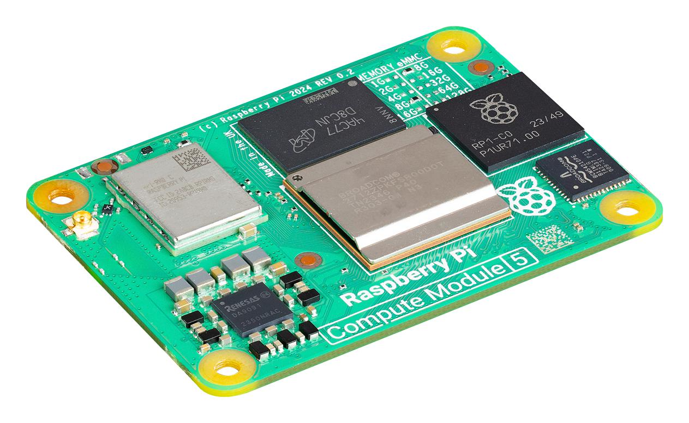

# Documention about PC and laptop hardware for IT support

* RAM stand for random access memory, is a short-term memory for computer. Acive when computer running and erase temporary data when computer off

---
## Types of RAM
#### DDR1:
* Intel: Pentium 4, Celeron (Socket 478/775).
* AMD: Athlon XP, Sempron (Socket A, 754).
#### DDR2:
* Intel: Core 2 Duo, Core 2 Quad, Pentium Dual-Core (Socket 775).
* AMD: Athlon 64 X2, Phenom (Socket AM2, AM2+).
#### DDR3 / DDR3L:
* Intel: Core i thế hệ 1, 2, 3 ,4 (Socket 1156, 1155, 1150).
* AMD: Phenom II, FX Series (Socket AM3, AM3+, FM1, FM2, FM2+).
#### DDR4:
* Intel: Core i gen 6, 7, 8, 9, 10, 11 and some mainboards support DDR4 gen 12, 13, 14 (Socket 1151, 1200, 1700).
* AMD: Ryzen gen 1, 2, 3, 4, 5 (Socket AM4).
#### DDR5:
* Intel: Core i gen 12, 13, 14 (mainboards support DDR5) and Core Ultra Series 2 (Socket LGA 1851 / LGA 1700).
* AMD: Ryzen 7000, 8000, 9000 up (Socket AM5).

## Check your computer RAM

### For laptops
* Check the laptop's exact model using the manufacturer's website or official service manual.

* Check the RAM specifications and whether the memory is upgradeable.

* If necessary, open the laptop and inspect the RAM slots, following the manufacturer's disassembly instructions and safety precautions.
#### Laptops with Upgradeable RAM (Common in Workstations,Gamings)
* Identify the supported RAM generation: DDR2, DDR3, DDR4, or DDR5.

* Check the supported memory speed, capacity, and module type (SO-DIMM or another supported format).

* Verify the CPU and motherboard memory specifications before purchasing RAM.

* Check the number of available RAM slots and the maximum supported memory capacity.
---

---
#### Laptops with Soldered RAM (Common in Ultrabooks)
* Some laptops use soldered LPDDR memory, such as LPDDR4X or LPDDR5, which generally cannot be upgraded separately.

* Some laptops also have soldered DDR memory.

* Check the manufacturer's specifications to confirm whether the RAM is soldered or upgradeable.
---

---
#### Important: Laptop and desktop RAM modules commonly use different physical form factors. Laptops typically use SO-DIMMs, while desktop PCs typically use DIMMs. Compatibility depends on the motherboard, supported memory generation, module type, and system specifications.

---

---
### For Desktop PCs

- Turn off the computer and unplug the power cable and peripheral connections.
- Open the PC case and follow electrostatic discharge (ESD) precautions.
- Locate the RAM modules and slots. Remove the RAM only if necessary, following the motherboard manual.

#### Desktop PCs with RAM Slots (Most Desktop PCs)

- Identify the supported RAM generation: DDR2, DDR3, DDR4, or DDR5, depending on the motherboard.
- Check the supported memory speed, maximum capacity, and number of RAM slots.
- Desktop RAM modules (DIMMs) are generally longer than laptop SO-DIMMs.
- **Important:** Some CPU families support multiple RAM generations, but the motherboard determines which generation can be installed. For example, 12th- and 13th-generation Intel desktop platforms commonly support either DDR4 or DDR5, depending on the motherboard.
---

---
#### Mini PCs with Laptop-Style RAM Slots (Some Lenovo, HP, and Dell Models)

- Identify the supported RAM generation: DDR3, DDR4, or DDR5, depending on the model.
- Check the supported memory speed, maximum capacity, and SO-DIMM compatibility.
- Some older Intel 6th- and 7th-generation platforms support DDR3L or DDR4, depending on the CPU and motherboard.
- Check the manufacturer's service manual before purchasing or installing RAM.
---

---
#### Ultra-Compact PCs with Soldered RAM (Raspberry PI PC and OEM tiny PC)

- Some ultra-compact PCs use soldered memory that cannot be upgraded separately.
- Verify the memory configuration in the manufacturer's specifications before purchasing the device.
---

